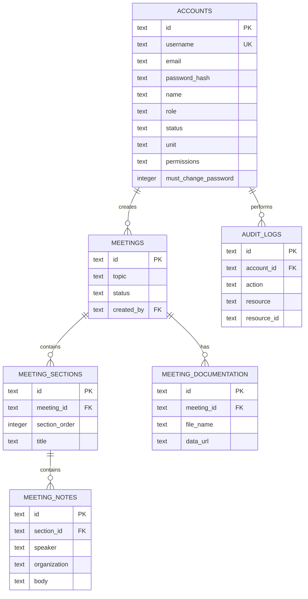

# ERD E-DITRENDUK — Backend V3

Tabel operasional `monitoring`, `logbook`, `archive`, `disposisi`, `petugas`, dan `schedules` masih memakai kolom `payload` JSON pada tahap migrasi dari prototype Excel. Ini sengaja agar UI lama tetap kompatibel. Pada migrasi PostgreSQL production, field yang stabil dapat dinormalisasi menjadi kolom relasional.
